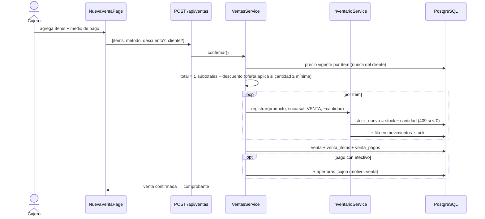
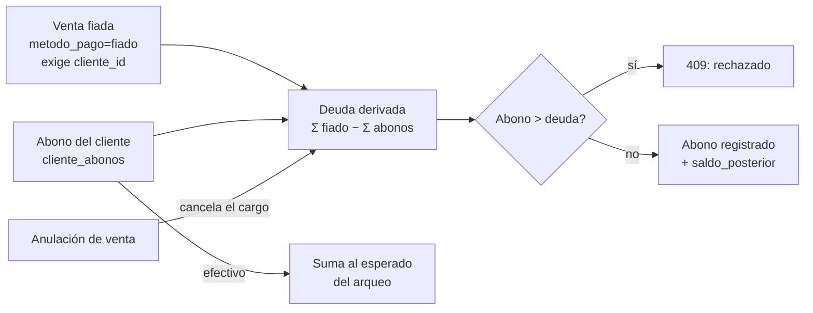
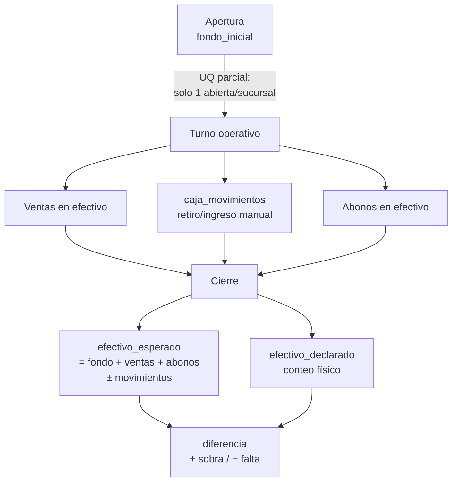
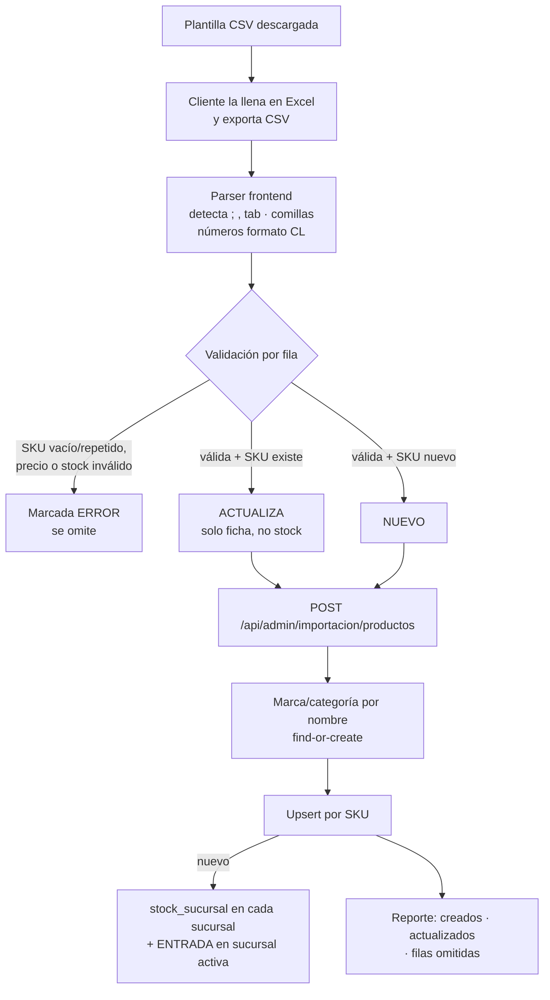

# KPP — Modelo de datos y flujos

Esquema vigente **post-V17**. Fuente sincronizada en el repo:
`.devin/rules/backend-bd-esquema.md` (su regla exige actualizarla en cada
migración). Este doc es la vista visual: ER completo + flujos de dominio.

> **Modelo mental**: el catálogo (`marcas`, `categorias`, `productos`) es
> **compartido** entre sucursales; todo lo operativo (stock, ventas, caja,
> clientes, despachos, ofertas) vive **acotado por `sucursal_id`**. El stock
> es saldo derivado de `movimientos_stock` — nunca se toca a mano.

## Diagrama ER

```mermaid
erDiagram
    usuarios ||--o{ usuario_sucursal : "opera en"
    sucursales ||--o{ usuario_sucursal : "tiene"
    usuarios ||--o{ ventas : "registra"
    sucursales ||--o{ ventas : "vende"
    clientes ||--o{ ventas : "compra (null ok)"
    ventas ||--|{ venta_items : "contiene"
    productos ||--o{ venta_items : "es ítem"
    ventas ||--|{ venta_pagos : "se paga con"
    marcas ||--o{ productos : "clasifica"
    categorias ||--o{ productos : "agrupa"
    productos ||--o{ stock_sucursal : "tiene saldo"
    sucursales ||--o{ stock_sucursal : "en"
    productos ||--o{ movimientos_stock : "mueve"
    sucursales ||--o{ movimientos_stock : "en"
    ventas ||--o{ movimientos_stock : "origen"
    usuarios ||--o{ movimientos_stock : "ejecuta"
    sucursales ||--o{ clientes : "registra"
    clientes ||--o{ cliente_abonos : "abona"
    usuarios ||--o{ cliente_abonos : "recibe"
    ventas ||--o{ cliente_abonos : "cobro junto (V10)"
    sucursales ||--o{ caja_sesiones : "abre"
    usuarios ||--o{ caja_sesiones : "opera"
    caja_sesiones ||--o{ caja_movimientos : "contiene"
    sucursales ||--o{ aperturas_cajon : "audita"
    usuarios ||--o{ aperturas_cajon : "abre"
    ventas ||--o{ aperturas_cajon : "origen"
    productos ||--o{ ofertas : "tiene oferta"
    sucursales ||--o{ ofertas : "aplica en"
    ventas ||--o| despachos : "genera (máx 1)"
    sucursales ||--o{ despachos : "despacha"
    zonas_despacho ||--o{ despachos : "tarifica"
    sucursales ||--o{ zonas_despacho : "define"

    usuarios {
        bigint id PK
        string correo UK
        string rol "root|admin|user"
        boolean activo
        timestamptz clave_actualizada_en "V16: revoca JWT"
        boolean tutorial_completado "V17"
    }
    sucursales {
        bigint id PK
        string nombre UK
        boolean activa
    }
    productos {
        bigint id PK
        string sku UK
        string codigo_barras "UQ parcial, null ok"
        string nombre
        bigint marca_id FK
        bigint categoria_id FK
        numeric precio "$/unidad o $/kg si a_granel"
        boolean a_granel
        boolean activo
    }
    stock_sucursal {
        bigint producto_id FK "UQ(producto,sucursal)"
        bigint sucursal_id FK
        numeric stock "NUMERIC(12,3), sin fila = 0"
        numeric stock_minimo "alerta"
    }
    movimientos_stock {
        bigint id PK
        string tipo "entrada|salida|ajuste|venta|anulacion"
        numeric cantidad
        bigint venta_id FK "null"
        bigint usuario_id FK "null"
    }
    ventas {
        bigint id PK
        bigint usuario_id FK
        bigint sucursal_id FK
        bigint cliente_id FK "null; NOT NULL si hay fiado"
        numeric total "items - descuento, IVA inc."
        string estado "confirmada|anulada"
        string metodo_pago "efectivo|tarjeta|transferencia|fiado|mixto"
        numeric descuento
        numeric costo_despacho "V13"
    }
    venta_items {
        bigint venta_id FK
        bigint producto_id FK
        numeric cantidad "kg si granel"
        numeric precio_unitario
        numeric subtotal
    }
    venta_pagos {
        bigint venta_id FK
        string metodo
        numeric monto "1 fila = medio único; 2+ = mixto"
    }
    clientes {
        bigint id PK
        string nombre
        string rut "UQ(sucursal,rut), null ok"
        bigint sucursal_id FK
    }
    cliente_abonos {
        bigint cliente_id FK
        numeric monto "CHECK > 0"
        string metodo
        bigint venta_id FK "null: abono junto a venta"
        numeric saldo_posterior
    }
    caja_sesiones {
        bigint sucursal_id FK "UQ parcial abierta"
        numeric fondo_inicial
        timestamptz cerrada_en
        numeric efectivo_esperado
        numeric efectivo_declarado
        numeric diferencia
    }
    despachos {
        bigint venta_id FK "UQ"
        string estado "pendiente|en_reparto|entregado|cancelado"
        bigint zona_id FK "null"
        numeric costo
    }
    ofertas {
        bigint producto_id FK
        bigint sucursal_id FK
        numeric cantidad_minima
        numeric precio
        boolean activa
    }
```

**Derivadas (no columnas)**: deuda del cliente = `Σ venta_pagos(fiado)
confirmadas − Σ cliente_abonos`; `neto`/`iva` de venta = `total/1.19` al
responder. **En memoria, no tabla**: `ScanBandeja` (buzón de escaneos).
**Eliminadas en V15**: `documentos_dte`, `sucursal_emisor` (DTE quedó
fuera del alcance).

## Flujo 1 — Venta POS

## Flujo 2 — Fiado y cuenta corriente

## Flujo 3 — Caja (apertura → arqueo)

## Flujo 4 — Importación de catálogo (V, 2026-10-29)

## Historial de migraciones

V1 init · V2 código de barras · V3 multi-sucursal · V4 granel · V5 caja/pagos
· V6 descuentos · V7 clientes/fiado · V8 DTE · V9 RUT · V10 abono en venta
· V11 ofertas · V12 despachos · V13 zonas+costo · V14 cajón auditado
· **V15 rollback DTE** · V16 revocación de sesiones · V17 tutorial.

Detalle por tabla/índice: `.devin/rules/backend-bd-esquema.md` en el repo.
